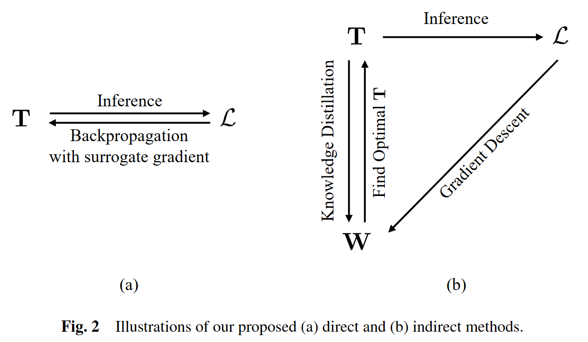
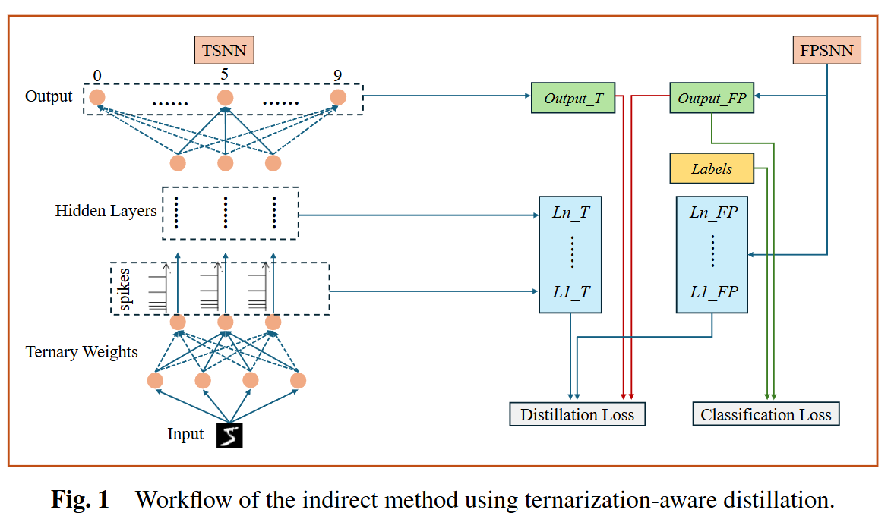

# Ternary Quantization of Spiking Neural Networks

<p align="center">
  
</p>

Official implementation of the paper **[Ternary quantization of spiking neural networks](https://doi.org/10.1007/s11704-025-51519-1)** (*Frontiers of Computer Science*, 2027).

Spiking neural networks (SNNs) suit resource-constrained hardware, but full-precision models are still expensive in memory and compute. This repository trains SNNs with ternary weights (-1, 0, +1) and studies how quantization affects their uncertainty. It contains:

- **Direct ternary quantization**: the forward and backward passes use ternary weights, and the gradients update a full-precision copy of the weights.
- **Indirect ternary quantization**: alternate full-precision training with weight quantization.
- **Indirect quantization with knowledge distillation (KD)**: a full-precision teacher guides the quantized student.
- **Uncertainty quantification**: compare the uncertainty of full-precision, direct, and indirect models.
- **Uncertainty optimization**: a regularization term that reduces the uncertainty of quantized models.

The methods are implemented on four SNN families: PLIF, SNN with dropout, SNN with dropconnect, and SLAYER.

<p align="center">
  
</p>

## Repository structure

```text
.
├── Ternary_Quantization_SNN/
│   ├── PLIF/                # PLIF networks: baselines, direct, indirect, KD
│   ├── SNN_dropout/         # MNIST / CIFAR-10: direct, indirect, KD
│   ├── SNN_dropconnect/     # MNIST / CIFAR-10: direct, indirect, KD
│   └── Slayer/              # Bundled SLAYER framework + N-MNIST MLP experiments
└── Uncertainty_Qualification_and_Optimization/
    ├── Unceritianty_Qualification/   # Uncertainty quantification, one folder per model
    └── Uncertainty_Optimization/     # Regularization-based uncertainty optimization
```

| Model family | Entry scripts | Guide |
| --- | --- | --- |
| PLIF | `codes/direct.py`, `codes/indirect.py`, `codes/indirectKD.py` | [English](Ternary_Quantization_SNN/PLIF/README.md) · [中文](Ternary_Quantization_SNN/PLIF/README_cn.md) |
| SNN dropout | `{MNIST,CIFAR}_{direct,indirect,indirectKD}.py` | [README](Ternary_Quantization_SNN/SNN_dropout/README.md) |
| SNN dropconnect | `{MNIST,CIFAR}_{direct,indirect,indirectKD}.py` | [README](Ternary_Quantization_SNN/SNN_dropconnect/README.md) |
| SLAYER | `example/02_NMNIST_MLP/nmnistMLP_{direct,indirect}.py` | [README](Ternary_Quantization_SNN/Slayer/README.md) |
| Uncertainty quantification | `UncertaintyQualification.py` in each model folder | [README](Uncertainty_Qualification_and_Optimization/Unceritianty_Qualification/README.md) |
| Uncertainty optimization | `SNN_dropout_UO.py`, `SNN_dropconnect_UO.py`, `Slayer_UO.py` | [README](Uncertainty_Qualification_and_Optimization/Uncertainty_Optimization/readme.md) |

## Installation

```bash
git clone https://github.com/zhangsq-nju/TSNN.git
cd TSNN
```

The model families depend on incompatible versions of SpikingJelly, so use a separate environment for each:

| Environment | Used by | Install |
| --- | --- | --- |
| SpikingJelly `activation_based` | SNN dropout, SNN dropconnect, uncertainty experiments for them | `pip install -r requirements.txt` |
| SpikingJelly `clock_driven` (2020) | PLIF | `pip install -r Ternary_Quantization_SNN/PLIF/requirements.txt` |
| SLAYER | SLAYER experiments | see the [SLAYER README](Ternary_Quantization_SNN/Slayer/README.md) (CUDA extension build) |

All training scripts run on a CUDA GPU.

## Quick start

Train a ternary SNN with dropout on CIFAR-10 by direct quantization (the dataset is downloaded automatically):

```bash
cd Ternary_Quantization_SNN/SNN_dropout
python CIFAR_direct.py --epochs 100 --batch_size 128 --learning_rate 1e-4 -T 5
```

The scripts log to [Weights & Biases](https://wandb.ai). Set `WANDB_MODE=offline` to keep logs local.

## Datasets and pretrained models

- CIFAR-10, MNIST, Fashion-MNIST: downloaded through torchvision, except for the dropout/dropconnect MNIST scripts, which read the four IDX gzip files (`train-images-idx3-ubyte.gz`, `train-labels-idx1-ubyte.gz`, `t10k-images-idx3-ubyte.gz`, `t10k-labels-idx1-ubyte.gz`) from `--data_dir`.
- N-MNIST: a small subset is included for SLAYER (`NMNISTsmall/`). The SLAYER scripts also expect `NMNISTsmall.zip` in the working directory.
- PLIF direct quantization, the SLAYER quantization scripts, and the uncertainty experiments start from pretrained models. The checkpoints used in the paper are not included in this repository; train them with the baseline scripts first.

## Acknowledgements

This project builds on:

- [Parametric Leaky Integrate-and-Fire Spiking Neuron](https://github.com/fangwei123456/Parametric-Leaky-Integrate-and-Fire-Spiking-Neuron): PLIF models and training code
- [SLAYER PyTorch](https://github.com/bamsumit/slayerPytorch): SLAYER framework, bundled under `Ternary_Quantization_SNN/Slayer`
- [SpikingJelly](https://github.com/fangwei123456/spikingjelly)

The original READMEs of PLIF and SLAYER are kept as `README.upstream.md` in their folders.

## Citation

If you find this code useful, please cite:

```bibtex
@article{wu2027ternary,
  title   = {Ternary quantization of spiking neural networks},
  author  = {Wu, Yu-Lun and Tan, Rui-Rui and Zhang, Shu-Hao and Liang, Shuang and Liu, Zi-Ang and Wang, Zhao and Zhang, Shao-Qun},
  journal = {Frontiers of Computer Science},
  volume  = {21},
  number  = {2},
  pages   = {2102326},
  year    = {2027},
  doi     = {10.1007/s11704-025-51519-1}
}
```

## License

This project is released under the [GNU General Public License v3.0](LICENSE). It includes SLAYER PyTorch, which is also licensed under GPL-3.0.
